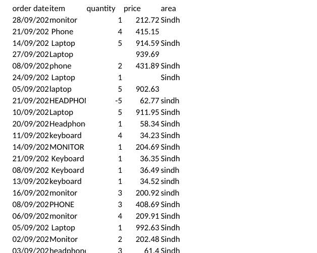
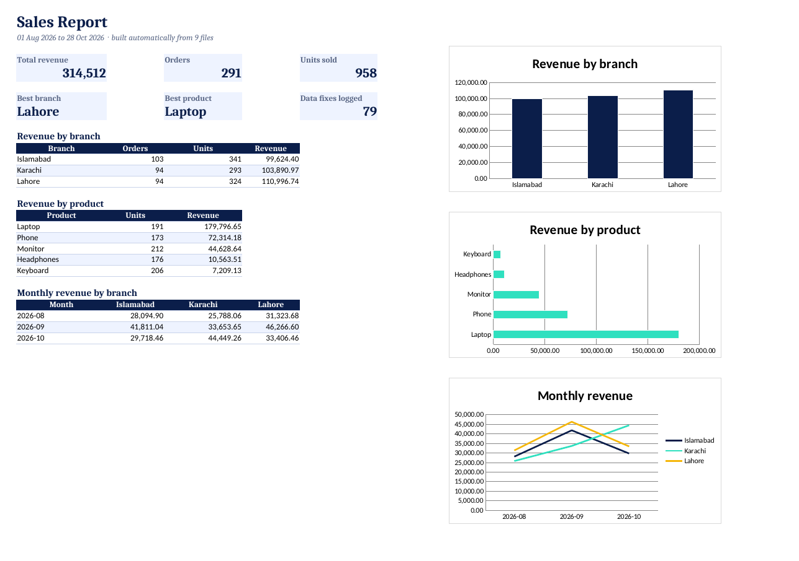

# Excel Report Automator

**Turn a folder of messy Excel files into one clean, formatted report in seconds.**

Many businesses get a spreadsheet from every branch, every month. Each one is a little different: other column names, three date formats, extra spaces, duplicate rows, missing prices and typos. Someone spends hours every month copying, fixing and making charts.

This script does it in one command, and it **logs every fix** so nothing changes silently.

| Before: 9 messy files | After: 1 clean report |
|---|---|
|  |  |

## What it does
1. **Reads every `.xlsx` file** in a folder, one per branch per month.
2. **Matches different column names**: `Qty`, `quantity` and `UNITS` all become `qty`.
3. **Reads dates in any format**: `2026-09-14`, `14/09/2026` and `14 Sep 2026`.
4. **Cleans the data**:
   - tidies product names (`" laptop "`, `LAPTOP` → `Laptop`);
   - removes duplicate rows;
   - removes missing or negative quantities;
   - fills missing prices with that product's median price;
   - fills blank regions from the branch.
5. **Builds one Excel report** with:
   - **Summary:** KPIs (revenue, orders, units, best branch, best product), tables by branch, product and month, and 3 native Excel charts;
   - **Clean data:** every row, with filters and a frozen header;
   - **Data fixes:** every problem found, with the file, row number and what was done.

## Result on the sample data
```
Read 9 files, 328 rows -> 291 clean rows, 79 fixes logged
Total revenue: 314,512.11
```

## How to run
```bash
pip install -r requirements.txt
python make_sample_data.py          # creates 9 messy sample files in input/
python automate_report.py --input input --output output/sales_report.xlsx
python -m pytest                    # 3 tests
```

**Use it on your own files:** put your `.xlsx` files in a folder and pass it with `--input`. If your columns have other names, add them to `COLUMN_NAMES` at the top of `automate_report.py`.

## Tools
Python · pandas · openpyxl (formatting and native Excel charts) · pytest

## Ideas to extend it
- Email the report automatically every month
- Read Google Sheets or CSV files too
- Run it on a schedule (Windows Task Scheduler, cron or GitHub Actions)

---
**Need something like this for your business?** I build automations for Excel, reports and data workflows.
Sara Abbasi · [abbasisarah.github.io](https://abbasisarah.github.io) · [GitHub](https://github.com/AbbasiSarah) · Instagram [@shecodess.ai](https://www.instagram.com/shecodess.ai/)
